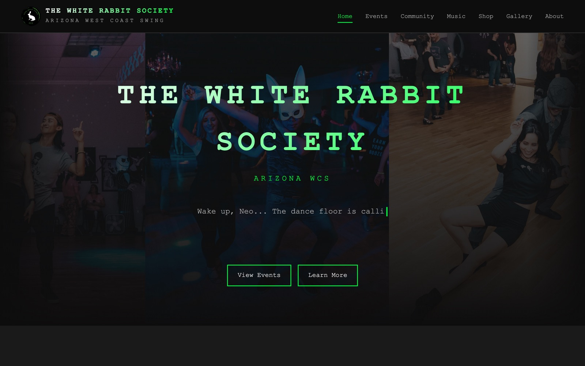
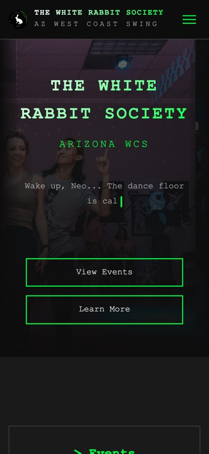

# Hi, I'm Devin

Full-stack software engineer with 8 years of experience. I build product UIs in React and TypeScript, the APIs and data behind them, and lately AI-powered workflows and agent tooling.

**Work with:** TypeScript · React · Remix · Astro · Node · Python · CSS/Tailwind and design systems · Shopify Hydrogen · Playwright · Claude, MCP, and agent workflows

## Projects

- **[whiterabbitwcs.com](https://whiterabbitwcs.com)**: hub for the Arizona West Coast Swing scene (events, instructors, venues, DJs). Astro. [Code](https://github.com/dvnrsn/white-rabbit-wcs)

   

- **[westerner.dance](https://westerner.dance)**: line dance library for a local country bar. [Code](https://github.com/dvnrsn/steel-cookie)
- **[eventkit-mcp](https://github.com/dvnrsn/eventkit-mcp)**: lets Claude manage macOS Calendar and Reminders, with guardrails so it can't change the wrong event. Swift + Python.

  
